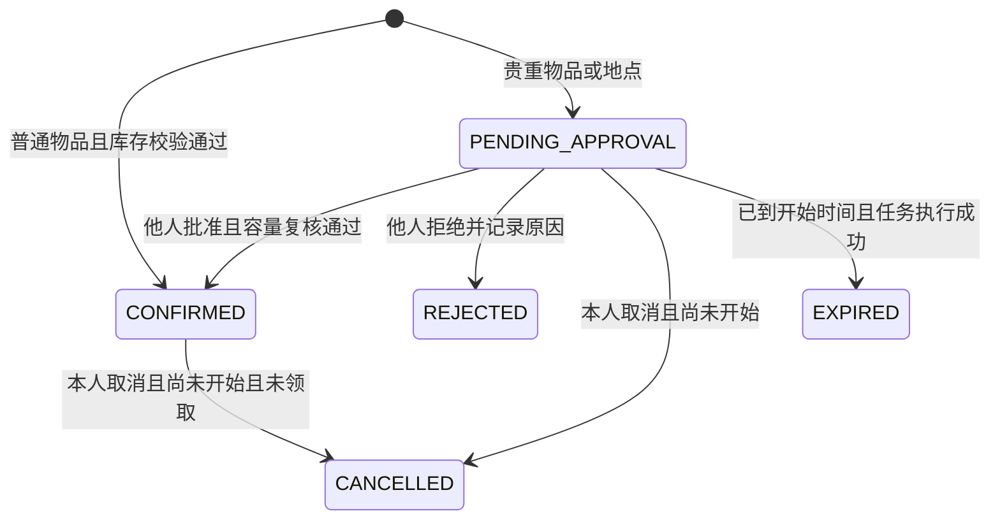
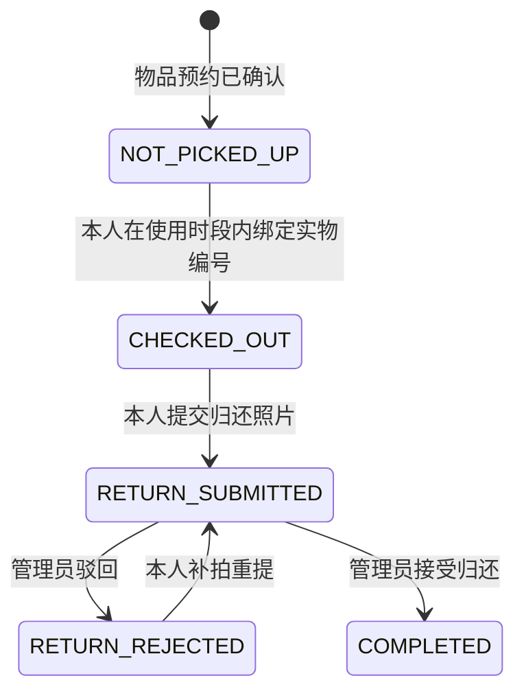

# 预约与借还状态说明

更新于 2026-11-15，对应 develop 的 c8142d7 功能版本。本文替代早期候补、辅导员优先占用等设计草案，说明当前代码实际使用的状态。接口字段以 [OpenAPI](../contracts/openapi/openapi.yaml)、Controller 与测试共同核对；规则变化时同步更新实现和说明。

## 预约主状态

资源类型为 `ITEM` 或 `SPACE`，可预约地点不使用 `ROOM`。预约主状态只有以下五种：

| status | 含义 | 如何进入 |
| --- | --- | --- |
| PENDING_APPROVAL | 待审核 | 贵重物品或地点提交成功 |
| CONFIRMED | 已确认 | 普通物品自动确认，或审核员批准 |
| REJECTED | 已拒绝 | 审核员拒绝并填写原因 |
| CANCELLED | 已取消 | 申请人取消自己尚未开始、尚未领取的申请 |
| EXPIRED | 已过期 | worker处理到达开始时间仍未获批的申请 |

已拒绝、已取消、已过期的记录保留供查询，不能再审批为已确认；需要重新申请时创建新的预约。已确认预约不会因到达结束时间自动变成 `EXPIRED`。当前没有候补、自动转正、辅导员挤占已确认预约、未领取自动取消或自动结束地点交接的流程。

## 物品交接状态

`handoverStatus` 只跟踪物品交接，与主状态分开。物品领取和归还完成后主状态仍为 `CONFIRMED`；地点不领取、不提交归还材料，交接状态保持空值。

| handoverStatus | 含义 | 库存处理 |
| --- | --- | --- |
| 空值 | 未进入物品交接，或属于地点预约 | 不据此推断库存，结合资源类型和预约状态 |
| NOT_PICKED_UP | 已确认但尚未领取 | 保留预约时段占用；尚未绑定实物 |
| CHECKED_OUT | 已领取 | 已绑定实物不可借 |
| RETURN_SUBMITTED | 已提交归还，等待核验 | 实物仍不可借 |
| RETURN_REJECTED | 归还核验被驳回 | 实物仍不可借，等待补拍重提 |
| COMPLETED | 核验接受，借还完成 | 核验事务将对应实物恢复为 AVAILABLE |

领取要求实物编号不重复、属于该物品、数量等于预约数量，且每件实物当前可借。领取时段为 `startAt <= 当前时间 < endAt`。已领取、已提交归还或归还被驳回的预约不能取消。取消成功时交接状态清空。

## 容量和时间

预约使用左闭右开区间 `[startAt, endAt)`，前一预约的结束时间等于后一预约的开始时间不算重叠。物品按申请区间内同时占用的峰值校验，不把互不重叠的预约数量直接累加。

当前可借实物数来自 `item_units.status=AVAILABLE`。未来时段的已确认预约也参与容量判断；`handover_status=COMPLETED` 的记录不再计入占用。不能只看主状态或只看结束时间判断实物是否可借：逾期、等待核验和核验驳回均不会恢复实物库存。

## 待审过期

触发条件为 `status=PENDING_APPROVAL` 且 `start_at <= 后端当前时间`，不是按提交后固定多少分钟超时。worker默认每30秒扫描一次，积压分批处理；停止worker会暂停自动处理，恢复后继续处理积压。

处理成功后写入：

- `status=EXPIRED`、`decision=EXPIRED`。
- `decision_reason=预约开始前未完成审核，申请自动过期`。
- `reviewed_at` 为系统处理时间，`reviewed_by` 为空，页面显示系统。
- 审计动作 `RESERVATION_EXPIRED`，保留原申请。

审核工作台本身不展示已到开始时间的待审记录；worker负责把这些记录的实际状态改为过期。即使worker暂时停止，审核端也不能批准已经开始的申请。已确认、已取消和已拒绝的申请不受此任务影响。

## 未归还提醒

提醒是单独的业务记录，不新增预约状态，也不改变实物状态。只有物品预约同时满足以下条件才生成：主状态已确认、交接为 `CHECKED_OUT` 或 `RETURN_REJECTED`、已到借用结束时间。

同一预约只保留一条提醒；用户只能看本人，系统管理员和审核员可查看全部。用户入口为“我的 → 我的预约 → 归还提醒”，管理端入口为“未归还提醒”。

提交归还后当前提醒暂不展示；核验驳回后重新展示；核验通过后不再展示，历史提醒记录仍保留。提醒仅在系统内可见，当前不发送邮件、短信或操作系统推送。只有管理员核验接受才恢复可借库存。

## 审核与任务并发

审核会再次锁定资源并检查申请状态；同一申请的并发审批只允许一次成功。任务完成时锁定任务和预约，再判断是否仍符合处理条件，防止覆盖已变更的申请。

任务具有180秒租约，同一有效租约不重复领取；旧租约不能回写。相同租约重复提交完成结果不重复写业务记录或审计。失败最多尝试5次，最终失败保留供运维排查。详细接口、退避和恢复操作见 [独立任务服务说明](../docs/独立任务服务接口草案.md)。

## 实现与验证入口

- 预约创建、取消、审核：`ItemReservationService`、`SpaceService`、`ItemReservationRepository`。
- 领取、归还：`ItemHandoverService`；库存核验由目录模块的归还核验接口处理。
- 自动任务：`ReservationTaskService`、`worker/tasks.mjs`。
- 数据库：V6至V9建立预约和借还基础，V16扩展过期结论并增加任务与提醒；后续迁移从V17开始。
- 自动化和人工验收范围见 [预约测试说明](预约并发测试用例.md)。
