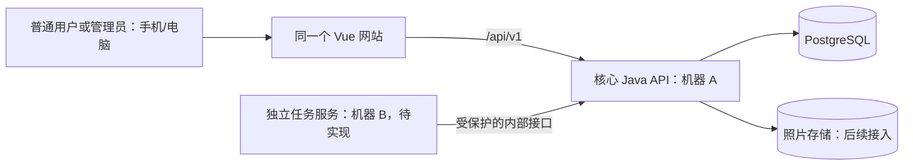

# 架构与首条联调链路

## 运行时结构

用户端和管理后台是同一前端工程，登录后按角色显示不同功能。前端不直接连接数据库。健康检查、地点列表和前端地点展示属于初始化闭环；资源模型、物品查询与写入、实物维护和展示照片接口已有实现，目录与管理业务使用本机测试身份完成浏览器验证。正式身份/范围授权、真实预约适配器、取件/归还提交和独立任务处理仍待接入。详见资源模型与物品接口说明。

## 第一次联调

1. 组员从 GitHub 克隆项目，在本机启动 PostgreSQL、后端和前端。
2. 浏览器打开前端，本地 Vite 将 `/api` 请求代理到后端。
3. 前端请求 `GET /api/v1/locations`；后端从数据库读取四条占位地点并返回。
4. 将占位名称替换为学院正式名称时，使用后续迁移脚本或管理接口，不手工改共享数据库。

接口路径、请求和响应以 `contracts/openapi/openapi.yaml` 为准。修改字段时由对应前后端负责人在同一个 PR 中同步修改代码与契约。

## 两台机器的课程演示

初期允许所有服务在一台电脑上调试。验收前让核心 API 和独立任务服务分别在机器 A、B 上运行，由 B 调用 A 的内部接口处理一个实际的预约到期或逾期任务，保存两侧日志和部署图。照片存储和数据库可按实际资源放在受保护的机器或托管服务上；不得把数据库端口直接开放给普通用户。
