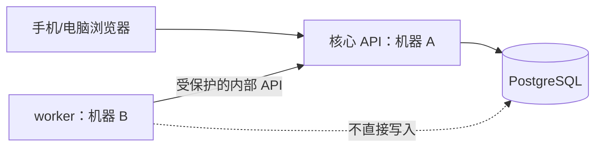

# 独立任务服务接口草案（尚未实现）

这份文档只供后续开发 `worker/` 时讨论，**不是当前可调用的接口清单**。现在 worker 只有 `GET /health`；`POST /jobs/run` 明确返回 503。后端的任务领取、服务身份、提醒处理与两机部署都没完成。

待实现的第一批任务可以是待审申请到期、预约到期和未归还提醒。任务状态、执行时间和通知方式须先由预约模块确认，再设计表和接口。

| 拟议接口 | 用途 | 必须保证 |
| --- | --- | --- |
| `POST /api/v1/internal/tasks/claim` | worker 领取任务 | 单独的服务身份、任务租约、同一任务不被重复领取 |
| `POST /api/v1/internal/tasks/{id}/complete` | 提交完成结果 | 核验租约和防重复键；网络超时可安全重试 |
| `POST /api/v1/internal/tasks/{id}/fail` | 记录失败并安排重试 | 有次数上限，最终交管理员处理 |

worker 不使用普通用户账号，也不直接连接核心数据库。密钥放环境配置，不能提交仓库；跨机器调用要鉴权、设超时并记录不含密码和照片的处理日志。正式实施前，先把字段、状态和错误响应写进 `contracts/openapi/openapi.yaml`，再做实际接口及两台机器的验证。
