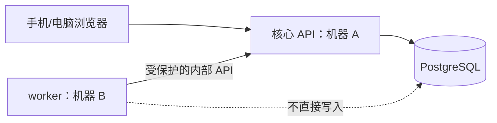

# 独立任务服务：接口与运行说明

更新于 2026-11-17。文件名沿用旧草案名，以下内容对应当前实现：Java API 保存任务与业务结果，Node worker 独立轮询处理。已完成阿里云 Linux 与 Windows 本机跨机器受限联调，验证自动过期、未归还提醒和 worker 进程自动恢复；详见[部署记录](2026-11-17%20云端部署与两机联调记录.md)。课程最终验收仍需小组演示。



## 已实现的业务

- 待审过期：`status=PENDING_APPROVAL` 且 `start_at <= 后端当前时间`，物品与地点均改为 `EXPIRED`。预约日志记录 `decision=EXPIRED`、系统处理时间与“预约开始前未完成审核，申请自动过期”；审计记录动作 `RESERVATION_EXPIRED`。已确认、已取消、已拒绝的申请不变。
- 未归还提醒：仅已确认物品、已领取或归还核验被驳回、`end_at <= 后端当前时间` 时生成，每份预约只保留一条提醒。用户在“我的 → 我的预约 → 归还提醒”查看本人提醒；审核员和系统管理员在“未归还提醒”查看全部。提醒显示应归还时间、申请人与实物编号。
- 已提交归还材料时提醒暂不展示；核验驳回后重新展示，通过核验后不再展示。原提醒记录保留。未领取、等待核验和借还完成的预约不会新生成提醒。
- 任务服务不更新实物状态、不恢复库存、不代替归还核验；逾期物品仍占用实物，只有原有管理员核验接受流程释放。
- 默认每30秒轮询，每批最多20条，非瞬时处理；积压会分批消化。worker停止时不会自动过期或生成新提醒，恢复后补处理到期积压。

| 已实现接口 | 用途 | 保证 |
| --- | --- | --- |
| `POST /api/v1/internal/tasks/claim` | worker 领取任务 | 单独的服务身份、任务租约、同一任务不被重复领取 |
| `POST /api/v1/internal/tasks/{id}/complete` | 提交完成结果 | 同一任务ID和租约令牌可安全重试；再次锁定预约检查最新状态 |
| `POST /api/v1/internal/tasks/{id}/fail` | 记录失败并安排重试 | 有次数上限，最终交管理员处理 |

内部三个接口使用 `Authorization: Bearer <TASK_SERVICE_TOKEN>`，令牌至少32字符；未配置时拒绝访问。用户会话不能替代服务身份。浏览器接口仍使用会话与CSRF，内部链的豁免不影响用户写操作。字段和错误响应见 [OpenAPI](../contracts/openapi/openapi.yaml)。

## 租约、重试和可追溯性

`background_tasks` 唯一键为任务类型与预约ID。领取时加行锁，租约180秒，并行worker不会拿到同一个有效租约。失联租约到期后重新领取；旧令牌不能提交。已完成结果同令牌重复提交不重复修改预约、写提醒或审计。归还提交与任务并发时后端重新判断，已不符合条件的任务记为 `SKIPPED`；若随后核验驳回，提醒任务可重新进入队列。

处理失败按10/20/40/80秒退避，轮询时间也影响实际重试时间；含租约失联在内最多尝试5次，最终记为 `FAILED`。任务本身失败不会强行改变预约。运维需查看 `background_tasks` 的 `last_error`、修复原因，再对明确需要重试的任务ID执行下列操作；当前没有失败任务管理页面：

```sql
SELECT id,type,reservation_id,attempts,last_error FROM background_tasks WHERE state='FAILED';
-- 将 :task_id 换成确认过的失败任务ID；只重置该条失败任务。
UPDATE background_tasks SET state='PENDING',attempts=0,available_at=CURRENT_TIMESTAMP,
  lease_token=NULL,lease_until=NULL,last_error=NULL,completed_at=NULL
WHERE id=:task_id AND state='FAILED';
```

`GET /api/v1/return-reminders?managed=false&page=0&size=20` 返回本人当前提醒；`managed=true` 要求管理角色。每页最多100条。

## 在本地或两台机器运行

按 [worker说明](../worker/README.md) 配置和启动。机器A运行Java后端与数据库，机器B运行worker，将B的 `TASK_API_URL` 指向A可达的后端地址，并配置相同服务密钥。worker不连接数据库；不要向公网暴露数据库或手动触发端口。跨机器使用受保护内网或HTTPS。实际两机验收需保留两端日志、任务结果和重复执行/断线恢复记录；单机两个进程不代表已满足两机验收。
