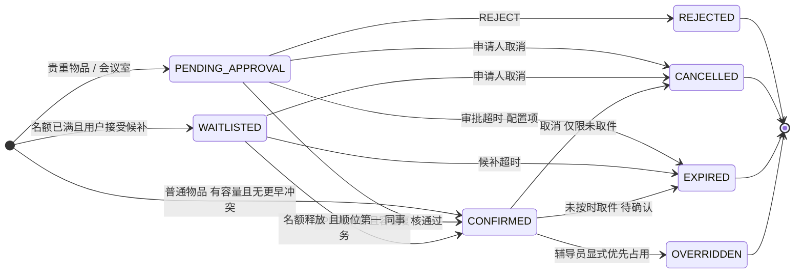
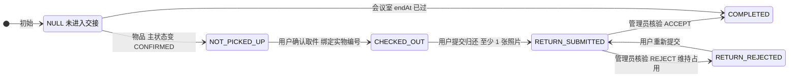

# 预约状态图与状态迁移规则

> 对应 Issue：#4（[预约] 预约状态机、时间冲突检测与单人审批接口）
> 负责人：5 号（预约与审批后端）
> 依据：`docs/开发约束.md` 3.1–3.4、5.4；`docs/八周开发分工与验收清单.md`
> 状态：**待评审**（需 1 号、2 号、6 号确认，见第 9 节）

本文是预约模块的**唯一状态定义来源**。后端枚举、数据库列、OpenAPI 的 `Reservation` schema、前端展示文案，都必须以本文为准；出现不一致时改代码，不改本文（改本文须走 PR 并通知 2/4/6 号）。

---

## 1. 为什么要拆成两个维度

`开发约束.md` 3.1 已经写明：主状态有 7 个（`PENDING_APPROVAL`、`WAITLISTED`、`CONFIRMED`、`REJECTED`、`CANCELLED`、`EXPIRED`、`OVERRIDDEN`），物品在确认**之后**另有一套交接状态（`NOT_PICKED_UP`、`CHECKED_OUT`、`RETURN_SUBMITTED`、`RETURN_REJECTED`、`COMPLETED`）。

这两套状态的性质完全不同：

| | 主状态 `status` | 交接状态 `handoverStatus` |
|---|---|---|
| 回答的问题 | 这次申请**有没有拿到名额** | 物品**走到哪一步了** |
| 谁会改 | 系统（自动确认/超时）、审核员、用户、辅导员 | 用户（取件/归还）、资源管理员（核验）、定时任务（会议室结束） |
| 会议室用不用 | 用 | 只用 `COMPLETED` 一个值 |
| 是否影响容量 | **是，唯一依据** | 是，仅 `COMPLETED` 会释放 |

如果把两者挤进一个 `status` 列（PR #2 当前写法），会有两个后果：

1. **容量统计必然漏判**。判定条件会变成 `status IN ('CONFIRMED','RETURN_SUBMITTED','RETURN_REJECTED',...)`，只要漏一个值就放行一件已经借出去的物品，直接超借。
2. **状态机无法表达合法组合**。"已审批通过 + 已取件"只能用 `CHECKED_OUT` 覆盖 `CONFIRMED`，审批信息在状态字段上就丢了，`GET /reservations/{id}` 无法回答"谁在什么时候批的"。

拆成两列后，容量判定**只需要看一个值**：`status = 'CONFIRMED'`。这不是"少写几个 OR"，而是让"漏判"在语法上不可能发生。

---

## 2. 主状态机（审批与名额维度）



**四个终态**：`REJECTED`、`CANCELLED`、`EXPIRED`、`OVERRIDDEN`。终态一经进入不可再迁移，任何"复活"请求一律 `409 INVALID_STATE`；用户想重来就提一条新申请（新 `id`、新 `submission_seq`），历史记录保留。

**`CONFIRMED` 不是终态**，它是"持有名额"的持续状态，可能被取消、被占用或按时完成后自然结束。这是它和 `COMPLETED` 容易混的地方 —— 见第 3 节。

---

## 3. 交接状态机（实物与履约维度）



> 会议室的边是 `NONE → COMPLETED`，不经过任何物品环节 —— 它没有取件和归还。

| 值 | 含义 | 适用资源 | 是否占用名额 |
|---|---|---|---|
| `NULL` | 尚未进入交接流程 | 物品（未确认）、会议室（未结束） | 看主状态 |
| `NOT_PICKED_UP` | 已确认，等待取件 | 物品 | 占用 |
| `CHECKED_OUT` | 已取件，实物在使用中 | 物品 | 占用 |
| `RETURN_SUBMITTED` | 已提交归还，等待核验 | 物品 | 占用（核验前不得重新分配） |
| `RETURN_REJECTED` | 核验驳回，维持占用 | 物品 | 占用 |
| `COMPLETED` | 履约结束，实物可重新分配 | 物品、会议室 | **不占用** |

三个容易写错的点：

1. **`RETURN_SUBMITTED` 和 `RETURN_REJECTED` 都必须占用名额**。`开发约束.md` 3.2 明确"已逾期未归还或待归还核验的实物不得重新分配"。只有核验通过（`ACCEPT`）才释放。
2. **会议室不用取件/归还流程**，它只有 `NULL → COMPLETED` 一条边。`开发约束.md` 3.1 说"会议室在使用时段结束后为 `COMPLETED`"，这里落在交接列，主状态仍是 `CONFIRMED` —— 这是本文对原文的一处解释，**需 1 号确认**（见第 9 节 D-1）。
3. **`COMPLETED` 不进主状态枚举**。它是履约结果，不是名额状态。对外展示时按 `handoverStatus` 覆盖：`handoverStatus = COMPLETED` 一律显示"已完成"。

---

## 4. 两列组合矩阵（合法组合白名单）

只有下表中的组合是合法的。数据库用 `CHECK` 约束兜底，服务层不依赖它做业务判断，但**违反它的任何写入都是 bug**。

| 主状态 `status` | 物品 `handoverStatus` | 会议室 `handoverStatus` |
|---|---|---|
| `PENDING_APPROVAL` | `NULL` | `NULL` |
| `WAITLISTED` | `NULL` | `NULL` |
| `CONFIRMED` | `NOT_PICKED_UP`、`CHECKED_OUT`、`RETURN_SUBMITTED`、`RETURN_REJECTED`、`COMPLETED` | `NULL`、`COMPLETED` |
| `REJECTED` | `NULL` | `NULL` |
| `CANCELLED` | `NULL` | `NULL` |
| `EXPIRED` | `NULL` | `NULL` |
| `OVERRIDDEN` | `NULL` | `NULL` |

由此可以直接推出两条业务事实：

- **已借出的不能取消**（`开发约束.md` 5.4）。`CANCELLED` 的 `handoverStatus` 必须是 `NULL`，而 `CHECKED_OUT` 要求 `status = CONFIRMED`，两者互斥，所以"取件后取消"在数据层面就写不进去。
- **终态一定是 `handoverStatus = NULL`**。被拒、被取消、超时、被挤占的申请，都还没进入交接流程。

---

## 5. 容量占用判定（唯一谓词）

所有"这个时段还剩几个名额"的计算，**必须**用下面这一个谓词，不允许各处各写一套：

```sql
-- 唯一权威定义：occupies_slot
status = 'CONFIRMED'
AND COALESCE(handover_status, '') <> 'COMPLETED'
```

实现上建议固化成生成列，让索引和应用查询共用同一个定义，避免"应用判一套、约束判另一套"：

```sql
ALTER TABLE reservations
  ADD COLUMN occupies_slot BOOLEAN
  GENERATED ALWAYS AS (
    status = 'CONFIRMED' AND COALESCE(handover_status, '') <> 'COMPLETED'
  ) STORED;

-- 会议室：容量恒为 1，交给数据库兜底
ALTER TABLE reservations
  ADD CONSTRAINT room_time_no_overlap
  EXCLUDE USING gist (
    room_id WITH =,
    tstzrange(start_at, end_at, '[)') WITH &&
  )
  WHERE (occupies_slot);
```

### 5.1 为什么 `OVERRIDDEN` 不占名额

`OVERRIDDEN` 的主语是**被挤占的原预约**（验收条件 #10："原预约转 `OVERRIDDEN`"）。它的时段已经交给辅导员那条新的 `CONFIRMED` 预约了，如果它自己还算占用，同一时段就会被数成 2 条，容量检查永远失败。

所以：**`OVERRIDDEN` = 已失效**，与 `CANCELLED` 同属"释放名额"的终态，区别只在"谁干的、有没有原因、有没有通知"。

### 5.2 为什么 `PENDING_APPROVAL`、`WAITLISTED` 也不占

会议室待审队列里，同一时段可能同时有多条 `PENDING_APPROVAL`（谁都能申请）；候补队列同理。它们不进排他索引，所以：

- 审核通过时才触发冲突检查 → 天然实现验收条件 #7「通过时容量已被占满 → `409 RESOURCE_CONFLICT`，状态保持 `PENDING_APPROVAL`」；
- 不需要在提交阶段就阻止多人申请同一时段，符合线下流程（学生各自提交，辅导员挑一个批）。

---

## 6. 状态迁移表

触发端一律是**命名明确的业务端点**，不允许前端 `PATCH status`（`开发约束.md` 5.4 末段）。

### 6.1 主状态迁移

| # | 从 | 到 | 触发 | 操作者 | 前置校验 | 副作用 |
|---|---|---|---|---|---|---|
| T1 | — | `CONFIRMED` | `POST /reservations`（普通物品） | `USER` | 时段合法、容量足够、无更早的有效冲突申请 | 分配 `submitted_at`、`submission_seq`；`handover_status = NOT_PICKED_UP`；写审计 |
| T2 | — | `PENDING_APPROVAL` | `POST /reservations`（贵重物品/会议室） | `USER`、`COUNSELOR_ADMIN` | 时段合法、未超提前天数与最长时长 | 冻结 `priority_tier`；写审计；通知审核组 |
| T3 | — | `WAITLISTED` | `POST /reservations`（用户接受候补） | `USER` | 容量已满且请求体声明接受候补 | 生成候补顺位；**不占用名额** |
| T4 | `PENDING_APPROVAL` | `CONFIRMED` | `POST /{id}/decision` `APPROVE` | `REVIEWER`、`COUNSELOR_ADMIN` | 审核人 ≠ 申请人；`status` 仍为 `PENDING_APPROVAL`；**重新检查冲突与容量** | 写审批记录；`handover_status` 置 `NOT_PICKED_UP`（物品）；通知申请人 |
| T5 | `PENDING_APPROVAL` | `REJECTED` | `POST /{id}/decision` `REJECT` | 同上 | 同上；`reason` 必填 | 写审批记录；释放候补顺位；通知 |
| T6 | `PENDING_APPROVAL` | `EXPIRED` | 定时任务 | 系统 | `now() > submitted_at + 审批超时配置` | 释放候补顺位；通知；写审计 |
| T7 | `PENDING_APPROVAL` | `CANCELLED` | `POST /{id}/cancel` | 申请人本人、管理员（须 `reason`） | `status` 属于可取消集合 | 释放候补顺位；写审计 |
| T8 | `WAITLISTED` | `CONFIRMED` | 名额释放事件（内部） | 系统 | 同资源同时段释放了名额；本申请为该队列 `priority_tier, submission_seq` 最小者；容量复核通过 | **与释放方同一事务**；置 `NOT_PICKED_UP`；通知 |
| T9 | `WAITLISTED` | `CANCELLED` / `EXPIRED` | `POST /{id}/cancel` / 定时任务 | 申请人、系统 | 同上 | 释放顺位；写审计 |
| T10 | `CONFIRMED` | `CANCELLED` | `POST /{id}/cancel` | 申请人本人、管理员 | `handover_status` ∈ {`NOT_PICKED_UP`}（会议室为 `NULL`）；已取件不允许 | 释放名额；**同事务触发 T8**；写审计 |
| T11 | `CONFIRMED` | `OVERRIDDEN` | `POST /{id}/override` | `COUNSELOR_ADMIN` | 仅会议室；`reason` 必填；不得覆盖本人申请 | 释放原时段；为辅导员创建新的 `CONFIRMED` 预约；通知原预约人；写审计 |
| T12 | `CONFIRMED` | `EXPIRED` | 定时任务 | 系统 | 物品：超时可取件窗口仍 `NOT_PICKED_UP`；会议室：不适用 | 释放名额；`handover_status` 保持；`item_units` 解绑；写审计 |

### 6.2 交接状态迁移

| # | 从 | 到 | 触发 | 操作者 | 前置校验 | 副作用 |
|---|---|---|---|---|---|---|
| H1 | `NULL` | `NOT_PICKED_UP` | 随 T1 / T4 落库 | 系统 | `status = CONFIRMED` 且为物品 | 计算可取件窗口 |
| H2 | `NOT_PICKED_UP` | `CHECKED_OUT` | `POST /{id}/pickup` | 申请人本人 | 预约属于本人；已到可取件时间；`unitIds` 可用且属于该物品；状态为 `NOT_PICKED_UP` | 绑定 `unit_id`、记 `picked_up_at`；`item_units` 置占用；写审计 |
| H3 | `CHECKED_OUT` | `RETURN_SUBMITTED` | `POST /{id}/return-submission` | 申请人本人 | 至少 1 张照片且类型/尺寸合规；状态为 `CHECKED_OUT` 或 `RETURN_REJECTED` | 存照片元数据；记 `submitted_at`；通知核验人 |
| H4 | `RETURN_SUBMITTED` | `COMPLETED` | `POST /{id}/return-verification` `ACCEPT` | `RESOURCE_MANAGER`（须在授权范围） | 状态为 `RETURN_SUBMITTED` | **释放名额**；`item_units` 恢复可借；**同事务触发 T8**；写审计 |
| H5 | `RETURN_SUBMITTED` | `RETURN_REJECTED` | `POST /{id}/return-verification` `REJECT` | 同上 | `reason` 必填 | **维持占用**；通知申请人；写审计 |
| H6 | `RETURN_REJECTED` | `RETURN_SUBMITTED` | `POST /{id}/return-submission` | 申请人本人 | 同 H3 | 追加照片；写审计 |
| H7 | `NULL` | `COMPLETED` | 查询时惰性判定（会议室） | 系统 | `resource_type = ROOM` 且 `now() >= end_at` | 无需写库也可对外呈现；若回写则一次性批量 |

> **H7 的设计取舍**：会议室"结束"采用**查询时派生**（`now() >= end_at` 即视为已完成），不依赖 worker 定时扫描。这样即使 6 号的独立任务服务还没交付，会议室流程也完整可演示；worker 只负责 `EXPIRED` 这类**必须主动推动**的迁移。

### 6.3 非法迁移统一处理

下列请求一律返回 `409 INVALID_STATE`，且**不得产生任何写入**：

| 非法请求 | 说明 |
|---|---|
| `CANCELLED → CONFIRMED`、`REJECTED → CONFIRMED`、`EXPIRED → CONFIRMED` | 终态不可复活（验收条件 #13） |
| `WAITLISTED → CONFIRMED`（非顺位第一 / 非释放触发） | 候补只能按顺位转正 |
| `CONFIRMED`（`CHECKED_OUT` 及之后）`→ CANCELLED` | 已借出不能取消 |
| 审批一条已 `CONFIRMED` / 已 `REJECTED` 的申请 | 重复审批；两名审核员并发时后到者走此分支 |

**并发下的重复审批**（验收条件 #4）：两名审核员同时 `APPROVE`，只有一条审批记录落库，另一条返回 `409 INVALID_STATE`。实现用 `UPDATE ... WHERE id = ? AND status = 'PENDING_APPROVAL'` 的影响行数判断，**不要**先 `SELECT` 再 `UPDATE`。

---

## 7. 五条不变式

以下五条在任何时刻、任何并发交错下都必须成立。测试用例直接以它们为断言对象。

### I1 容量不变式

> 对任意资源、任意时间点，与该时段重叠且 `occupies_slot = TRUE` 的预约数，不得超过该资源的容量；会议室容量恒为 1。

```sql
SELECT COALESCE(SUM(quantity), 0) FROM reservations
 WHERE item_id = :itemId
   AND occupies_slot
   AND tstzrange(start_at, end_at, '[)') && tstzrange(:startAt, :endAt, '[)');
-- 结果必须 <= 该资源的可借量（会议室恒为 1；物品 = item_units 中 AVAILABLE 的行数）
```

会议室由 `room_time_no_overlap`（`EXCLUDE USING gist`）在数据库层保证，冲突时抛 `SQLState 23P01`，映射为 `409 RESOURCE_CONFLICT`。物品容量是聚合判断，SQL 约束表达不了，用 `pg_advisory_xact_lock(hashtextextended('ITEM:'||id, 0))` 在同一事务内串行化后重算。

**这一条是评分点，也是最容易被并发测试打穿的地方**：绝不允许"先查空闲、再无保护地插入"（`开发约束.md` 3.2 原文禁止）。

### I2 自审禁止

> 对任意审批记录，`approver_id ≠ applicant_id`。不因角色豁免 —— `SYSTEM_ADMIN` 也不行。

```sql
-- 审批落库前
WHERE r.id = :id AND r.applicant_id <> :approverId
```

违反时返回 `403 SELF_APPROVAL_FORBIDDEN`，且预约**保持 `PENDING_APPROVAL`**（验收条件 #8：不能"拒了它"当处理结果）。

### I3 迁移封闭

> 任意两次相邻的状态快照之间，只允许出现第 6 节表格中的边；不在表内的边不存在任何代码路径。

实现方式：状态写入集中在 `ReservationStateMachine` 一个类里，控制器和服务层不得直接 `UPDATE status`。所有状态写入 SQL 都带上前置状态条件（`WHERE status = :expected`），用影响行数判定成败。

### I4 顺位稳定

> `submitted_at` 与 `submission_seq` 一经落库不可修改；排序只看 `(priority_tier, submission_seq)`，与审批人点击按钮的时间无关。

- `submission_seq` 由数据库序列单调递增分配，只在**接收并持久化申请**时赋值（`开发约束.md` 3.2："客户端时间不参与排序"）。
- `priority_tier` 在提交时**冻结**：会议室申请人为 `COUNSELOR_ADMIN` → `0`，其余 → `1`；物品一律 `1`（物品只按提交顺序竞争）。冻结而非实时计算，可避免"授权变更后历史队列顺序漂移"。
- 禁止把 `decided_at`、`updated_at` 用作排序键。

### I5 终态必释放，释放必转正

> 任何进入 `CANCELLED` / `EXPIRED` / `OVERRIDDEN` 的预约，或 `handover_status` 变为 `COMPLETED` 的预约，都不再占用名额；且**同一事务内**必须尝试把该时段顺位第一的 `WAITLISTED` 转为 `CONFIRMED`。

```text
释放名额的动作（T6/T7/T9/T10/T11/T12/H4）
  └─ 同一事务 ─→ 取 (priority_tier, submission_seq) 最小的 WAITLISTED
                  └─ 容量复核通过 → UPDATE 为 CONFIRMED（T8）
```

两条硬要求：

1. **同一事务**。分两个事务会出现"名额已释放、候补未转正"的空窗，别人可以插进来，候补就永远等不到（验收条件 #15）。
2. **不依赖 worker**。候补转正由释放方同步完成，6 号的独立任务服务只做超时类迁移。这样 worker 未交付时本模块功能完整，联调不会被阻塞。

---

## 8. 边界与例外

### 8.1 逾期不是状态

`开发约束.md` 多处提到"逾期"，但 3.1 的状态枚举里**没有** `OVERDUE`。本模块**不新增该状态**，改用派生字段：

```text
overdue = (now() > end_at) AND handover_status IN ('CHECKED_OUT','RETURN_SUBMITTED','RETURN_REJECTED')
```

理由：逾期是"相对当前时间"的属性，不是一次状态迁移。若做成状态，就需要 worker 在每一秒扫全表去迁移，且"归还后"还得回退状态 —— 平白多一条非法迁移路径。`overdue` 随 `GET /reservations` 实时计算即可，6 号的提醒任务读同一个表达式。

### 8.2 提前天数与最长时长

`开发约束.md` 开篇明确这几项"须做成配置或资源字段，不能散落为硬编码常量"。校验在创建阶段一次性完成，超限返回 `400 VALIDATION_ERROR`，`details` 按字段名给出原因（验收条件 #14）：

```json
{ "code": "VALIDATION_ERROR",
  "message": "预约时间不满足规则",
  "details": { "startAt": "最多提前 14 天，实际 21 天",
               "endAt": "单次最长 4 小时，实际 6 小时" },
  "requestId": "..." }
```

### 8.3 幂等

所有改变状态的端点（`POST /reservations`、`/decision`、`/pickup`、`/override`）支持 `Idempotency-Key`（`开发约束.md` 5.2 要求）。键由客户端生成，服务端按 `(user_id, idem_key)` 唯一约束去重：

- 首次 → 正常执行，回填响应
- 重复且请求体哈希一致 → 返回**同一响应**（同 `id`、同状态码）
- 重复但请求体不同 → `400 IDEMPOTENCY_KEY_REUSED`

验收条件 #5 断言的是"两次返回同一 `id`"，不是"第二次报 409"。

### 8.4 待确认的配置项

| 配置 | 影响的状态迁移 | 缺省建议 |
|---|---|---|
| 审批超时 | T6 `PENDING_APPROVAL → EXPIRED` | 48 小时 |
| 可取件窗口 | T12 未取件超时 | `start_at` 起 24 小时 |
| 候补有效期 | T9 `WAITLISTED → EXPIRED` | 与审批超时一致 |
| 提前天数 / 最长时长 | 创建校验 | 14 天 / 4 小时 |

---

## 9. 需评审确认的决策点

以下 6 条是我在写本文时**必须做选择**的地方，已按最合理方案落笔，但需要相关人确认后才算定稿。

| 编号 | 决策 | 我的选择 | 需谁确认 | 影响 |
|---|---|---|---|---|
| D-1 | 会议室的 `COMPLETED` 放主状态还是交接状态 | 放交接状态，主状态保持 `CONFIRMED` | 1 号 | 若放主状态，主状态枚举变 8 个，容量谓词变 `status IN ('CONFIRMED') AND status <> 'COMPLETED'` 这类绕口写法 |
| D-2 | `OVERRIDDEN` 指原预约还是辅导员的新预约 | 指**被挤占的原预约**，不占名额 | 1 号、6 号 | 若理解反了，容量会双计，冲突检测永远失败 |
| D-3 | `override` 的 `action` 首版取值 | 先只支持 `CANCEL`（原预约 → `OVERRIDDEN`），`RESCHEDULE` 留扩展 | 1 号、6 号 | 影响 6 号审核工作台的按钮数量 |
| D-4 | `CONFIRMED` 未取件超时是否首版实现 | 实现，但**开关默认关闭**，避免影响演示 | 1 号、6 号 | 依赖 worker，未交付时不阻塞 |
| D-5 | `priority_tier` 是否冻结于提交时 | 冻结 | 1 号 | 若实时计算，授权调整会打乱既有队列 |
| D-6 | 对外 `status` 字段是否增加 `handoverStatus` 参数 | 增加，且 `status` 筛选只认主状态 | 2 号、4 号 | 4 号的筛选器需要多一个维度；PR #2 现有枚举需同步调整 |

---

## 10. 与其他模块的接口

| 依赖方 | 依赖内容 | 我方提供 |
|---|---|---|
| 3 号（物品/库存） | `items` / `item_units` 表结构、可借实物数（`items` 无 `capacity` 列，容量由 `AVAILABLE` 的 unit 数派生）、`ReservationReturnGateway` 实现约定 | 取件时绑定 `unit_id`；核验通过后释放；`item_units.status` 与 `handover_status` 的唯一写入方约定 |
| 4 号（管理端/物品端） | `Reservation` schema 与筛选参数 | 第 4 节组合矩阵、第 6 节迁移表 |
| 2 号（用户端） | 状态展示、我的预约列表 | `status` + `handoverStatus` + `overdue` 三字段 |
| 6 号（日历/审核台/worker） | `/rooms/{id}/calendar` 脱敏规则、审核队列排序 | 日历只返回"已占用"，不含他人姓名与事由（验收条件 #16）；队列按 `(priority_tier, submission_seq)` |
| 1 号（审计） | 审计接口 | 每个迁移点写操作者、时间、对象、动作、结果、前后状态 |

---

## 11. 本文件的验收方式

第 1 周交付物之一，验收标准是"能据此写出测试"，因此每条不变式都要有对应的可执行断言：

| 不变式 | 对应验收条件 | 测试类型 |
|---|---|---|
| I1 容量 | #1 #2 #3 #7 | 并发（真实多线程，不加 `@Transactional`） |
| I2 自审 | #8 | 单线程 + 权限 |
| I3 迁移封闭 | #13 | 参数化：遍历非法边 |
| I4 顺位 | #9 | 构造乱序提交，断言队列顺序 |
| I5 释放转正 | #15 | 事务内断言候补状态 |
| 附：幂等 | #5 | 同 key 两次调用，断言 `id` 相同、行数为 1 |
| 附：脱敏 | #16 | 断言响应体不含他人字段 |
